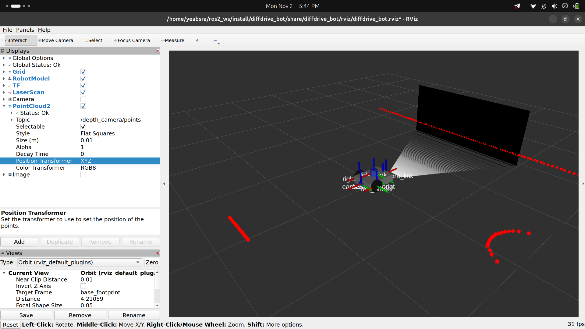
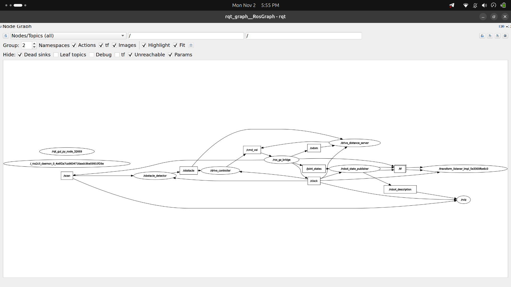

# ROS 2 Autonomous Mobile Robot Control Lab (Lab 1)

**Program:** BSc in Software Engineering
**Course:** Introduction to Robotics and Intelligent Systems
**Academic year:** 2026

## Overview

This lab develops an autonomous mobile robot application with ROS 2. It combines Python nodes,
custom messages, services, and actions with odometry feedback and a Gazebo simulation based on
`diffdrive_bot`. The final exercise uses action clients to coordinate forward driving and quarter
turns, guiding the robot around a square path.

The workspace contains four ROS 2 packages: `diffdrive_bot` supplies the simulated robot and its
base control nodes; `lab_interfaces` defines the obstacle and drive distance interfaces;
`my_robot_interfaces` defines the robot status, turn speed, and rotate interfaces; and
`my_robot_nodes` contains the turn away, rotate server, and square driver nodes.

## Repository Structure

```text
lab1_exercise/
├── diffdrive_bot/             # Robot model, Gazebo world, sensors, RViz, and base controllers
├── lab_interfaces/            # ObstacleInfo message, SetSpeed service, DriveDistance action
├── my_robot_interfaces/       # RobotStatus message, SetTurnSpeed service, Rotate action
├── my_robot_nodes/            # Turn away behavior, rotate server, square driver, launch file
├── rqt_graph.png               # Screenshot of the ROS node graph
└── rviz_depth_pointcloud.png   # Screenshot of the depth image and point cloud
```

## Prerequisites & Build Instructions

The lab targets **ROS 2 Humble on Ubuntu 22.04**. It was tested in a Distrobox container running
Ubuntu 22.04. The development computer was running Ubuntu 26, where the Humble-based lab environment
could not be used directly. Installing and using an Ubuntu 22.04 Distrobox container provided a
compatible environment and resolved that platform issue.

Install ROS 2 Humble and the simulation dependencies in Ubuntu 22.04, then clone the repository
directly into the workspace `src/` directory. Replace `<REPO_URL>` with the repository URL:

```bash
mkdir -p ~/ros2_ws/src
cd ~/ros2_ws/src
# git clone <REPO_URL> .
cd ~/ros2_ws
source /opt/ros/humble/setup.bash
rosdep install --from-paths src --ignore-src -r -y
colcon build --symlink-install
source install/setup.bash
```

For each new terminal, source both ROS 2 and the workspace overlays before running lab commands:

```bash
source /opt/ros/humble/setup.bash
source ~/ros2_ws/install/setup.bash
```

`--symlink-install` keeps Python and launch file edits visible from the source tree. Rebuild after
changing interface definitions or package metadata.

## Step-by-Step Execution Guide

Run the commands in separate terminals where indicated. Keep the simulation terminal running while
using the command terminals.

### Step 1: Simulation & Sensors

Start Gazebo, the ROS-Gazebo bridge, robot controllers, and RViz:

```bash
ros2 launch diffdrive_bot control.launch.py
```

Expected outcome: Gazebo loads the obstacle world with the robot, and RViz opens with the robot and
sensor displays. In RViz, set the **Fixed Frame** to `base_footprint` or `odom`. Enable the point
cloud display for the depth camera (the point cloud topic is bridged from Gazebo) and the camera's
depth image display. If the displays are not already configured, add **PointCloud2** and **Image**
displays and select the corresponding camera topics from their topic lists. The point cloud should
show nearby surfaces, and the depth image should change as obstacles appear at different distances.



### Step 2 & 3: Custom Message & Status Publisher

In a sourced terminal, run the status publisher:

```bash
ros2 run my_robot_nodes status_publisher
```

In another sourced terminal, inspect the status stream:

```bash
ros2 topic echo /robot_status
```

Expected outcome: the terminal prints `RobotStatus` messages containing a state and obstacle
distance. The current `my_robot_nodes` package in this repository does not include a
`status_publisher` executable; this command applies when that exercise node is present in the
course checkout. The `turn_away` node added in Step 4 also publishes `/robot_status` while it
receives obstacle messages.

### Step 4: Turn Away Behavior

Run the behavior node in a sourced terminal:

```bash
ros2 run my_robot_nodes turn_away
```

Expected outcome: when the obstacle detector reports a nearby obstacle, the node commands a turn
away from it; when the path is clear and the node is enabled, it commands forward motion. It
publishes the current motion state and measured obstacle distance on `/robot_status`. The node
starts disabled; use the enable service in Step 5 before expecting motion.

### Step 5: Services & Validation

Keep the simulation and `turn_away` node running. Enable the node:

```bash
ros2 service call /turn_away_enable std_srvs/srv/SetBool '{data: true}'
```

Set a valid turn speed (within the default maximum of 1.5 rad/s):

```bash
ros2 service call /set_turn_speed my_robot_interfaces/srv/SetTurnSpeed '{turn_speed: 1.0}'
```

Expected outcome: the response reports success and the new speed. Test an out-of-range speed:

```bash
ros2 service call /set_turn_speed my_robot_interfaces/srv/SetTurnSpeed '{turn_speed: 3.0}'
```

Expected outcome: the response reports failure and explains the permitted range. The current speed
remains unchanged.

### Step 6: Rotate Action Server

To test rotation independently, run the server in a sourced terminal with simulation time enabled:

```bash
ros2 run my_robot_nodes rotate_server --ros-args -p use_sim_time:=true
```

Send a quarter-turn goal and request feedback:

```bash
ros2 action send_goal --feedback /rotate my_robot_interfaces/action/Rotate "{angle: 1.57}"
```

Expected outcome: feedback reports the accumulated signed angle, and the robot stops after turning
approximately 1.57 radians. The server integrates the shortest signed yaw difference between
consecutive odometry readings. This delta accumulation avoids treating the yaw representation's
wrap from `+π` to `-π` (or vice versa) as a large rotation in the opposite direction.

### Step 7: Square Trajectory Orchestration & Launch File

Run the launch file with the desired square side length:

```bash
ros2 launch my_robot_nodes square.launch.py side_length:=0.8
```

Expected outcome: the launch file starts the `diffdrive_bot` control simulation, the rotate action
server, and the square driver. The driver sends four `DriveDistance` goals, each followed by a
`Rotate` goal for a left quarter turn. A successful run logs `Square trajectory completed
successfully!` after completing all four sides.



## What Did Not Work and Technical Analysis

### Ubuntu 26 host compatibility

The development computer ran Ubuntu 26, which did not provide the Ubuntu 22.04 environment
expected by the ROS 2 Humble lab setup. Trying to run the lab directly on the host prevented the
required environment from working reliably. Installing Ubuntu 22.04 in a Distrobox container gave
the project a compatible userspace while keeping the host system intact, and the lab then built and
ran in that container.

### Goal rejection during simulator startup

At launch, `square_driver` could begin sending goals before Gazebo had finished loading the robot
and publishing `/odom`. The `DriveDistance` server depends on odometry to validate and execute a
goal, so early goals could be rejected. The driver now waits until it receives odometry and applies
a short stabilization delay before starting. It also retries a drive goal rejected during startup.

### Executor thread blocking during actions

An action execute callback must continue receiving odometry while it waits and publishes feedback.
A single-threaded executor can block the odometry callback behind that long-running callback, so
the action cannot make progress. The rotate server uses a `MultiThreadedExecutor` and
`ReentrantCallbackGroup`, allowing odometry updates and action execution to proceed concurrently.

### Velocity carryover and drifting corners

Residual velocity at transitions between forward driving and rotation caused curved paths and
imprecise corners. The action servers send explicit zero `Twist` messages when their action ends,
and the square driver adds settling intervals after startup and between drive goals. These pauses
let the robot come to rest before the next segment begins.

### Simulation clock mismatch

Gazebo publishes simulation time on `/clock`. Nodes using wall time can become desynchronized from
the simulation, affecting timing and action behavior. The launch files set `use_sim_time: True` for
the simulation nodes and square driver; when running the rotate server manually, pass
`-p use_sim_time:=true` as shown in Step 6.
